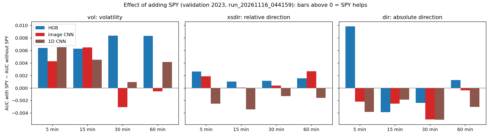

# AllData & AllModel

Every model on the full 2016–2025 data, with and without the market (SPY).

- **Notebook:** `AllData_AllModel.ipynb` (built by `tools/make_notebook.py`). Run on Colab with a GPU (L4 or A100).
- **Data:** `alldata_bundle_v1.zip`, built locally by `tools/build_alldata_bundle.py`. It holds licensed WRDS
  data, so it stays on Drive and is never committed.
- **Code:** `chartcnn/`, a copy of `CNN-Relevant/chartcnn` extended with SPY inputs (version `2026-11-16.1`).

## Data

| | |
|---|---|
| Universe | Daily S&P 500 ∪ NASDAQ 100 ∪ DJIA 30 members, by PERMNO: 775 securities, 516–531 a day |
| Sessions | 2,514 from 2016-01-04 to 2025-12-31; the 21 early-close sessions are excluded from windows |
| Bars | Five-minute OHLCV from TAQ trades, regular session, filters as in `US_EQUITY_ARCHIVE.md` |
| Market | SPY (PERMNO 84398) built with the same filters on the same clock |
| Adjustment | CRSP CIZ factors and cash dividends; each window is put on the basis of its own last bar |
| Split | train 2016–2022, validation 2023, test 2024–2025 |

**These results use `alldata_bundle_v1`**, built with trade-filter policy version 1. That filter dropped the
regular trades of non-Nasdaq-listed stocks (from 2018) and of Nasdaq-listed stocks (early 2016), so volume
inputs are biased by listing and year; prices are not affected (see `../DataCheck/README.md`). The v3
rebuild follows the steps in the root README: DataDownload, DataCheck, PriceAdjustment, Pipeline, then
`tools/build_alldata_bundle.py`.

**Distribution classification (CIZ).** A record with a cash amount and no price or share factor is a cash
dividend and gets the proportional chart adjustment. This covers ordinary, special, return of capital, capital
gains and non-USD dividends. A record with a factor is covered by the cumulative factors alone. 19,374 of
19,384 cash ex-date groups match CRSP's own `ret - retx` within 1%. That includes the 8 non-USD dividends of
CCEP and FER, whose CIZ amounts are already in USD; all 8 match to four decimals. The 10 that do not match are
return-of-capital / capital-gain mixes and one security exchange, where CRSP's `retx` treats part of the
payment differently. The price still drops by the full amount.

## Models per cell

| name | input | parameters |
|---|---|---|
| `plain` | stock chart 234×234 | 776,450 |
| `plain_spy` | stock chart over SPY chart, 468×234, bar columns aligned | 936,194 |
| `series1d` | 5 scaled OHLCV series | 720,770 |
| `series1d_spy` | 10 series: stock and SPY | 723,970 |
| HGB hand features | 20 features of the stock window | tree nodes, printed per cell |
| HGB hand + SPY | plus 18 SPY and stock-versus-SPY features | tree nodes, printed per cell |

Targets: `dir`, `vol` and `xsdir` at 5, 15, 30 and 60 minutes, stride 12.

## Results: `run_20261116_044159` (validation 2023)

**Key findings, in short** (AUC: 0.5 is a coin flip; on these targets a change of 0.005 or more is meaningful,
0.001–0.003 is noise):

1. **Only volatility is predictable.** Whether the next 5–60 minutes will move more than usual: AUC 0.63–0.69 for
   every model. Whether the price goes up (`dir`) or beats other stocks (`xsdir`): 0.49–0.52, close to a coin flip.
2. **Drawing the chart does not help.** The image CNN never beats HGB on hand features (worse in 8 of 12 cells) and
   is no better than a 1D CNN on the same numbers (better in 1, worse in 5).
3. **Adding SPY helps HGB, not the networks.** HGB gains +0.006 to +0.008 AUC on volatility at every horizon and
   +0.010 on direction at 5 minutes; it is higher in 10 of 12 cells and never significantly worse. The image CNN
   with the SPY panel is unchanged on average (+0.0002); the 1D CNN with SPY is slightly worse (−0.0005).
4. **The best model everywhere is HGB with SPY** (vol AUC 0.690 at 5 minutes).

Full run on an L4 (`QUICK = False`): 12 cells × 4 networks + 2 HGBs, 549 minutes. CNNs trained on 300,000
random training windows per cell; HGB on 1,000,000; every cell scored on all 247 validation days of 2023
(~570,000 windows). Files: `results/run_20261116_044159/` and the executed `AllData_AllModel.ipynb`.
The 2024–2025 test section has not been run.

Validation AUC (95% day-bootstrap intervals in `grid_table.csv`):

| model | vol 5 / 15 / 30 / 60 min | xsdir 5 / 15 / 30 / 60 min | dir 5 / 15 / 30 / 60 min |
|---|---|---|---|
| HGB hand + SPY | **0.690 / 0.672 / 0.668 / 0.680** | **0.520 / 0.512 / 0.510 / 0.508** | 0.516 / 0.497 / 0.498 / 0.507 |
| HGB hand features | 0.684 / 0.665 / 0.659 / 0.672 | 0.518 / 0.511 / 0.509 / 0.506 | 0.506 / 0.501 / 0.501 / 0.506 |
| 1D CNN + SPY | 0.664 / 0.646 / 0.634 / 0.654 | 0.508 / 0.500 / 0.502 / 0.500 | 0.499 / 0.501 / 0.490 / 0.502 |
| image CNN + SPY panel | 0.662 / 0.646 / 0.634 / 0.648 | 0.508 / 0.500 / 0.501 / 0.502 | 0.498 / 0.496 / 0.494 / 0.503 |
| image CNN | 0.658 / 0.639 / 0.637 / 0.649 | 0.507 / 0.500 / 0.501 / 0.500 | 0.500 / 0.498 / 0.499 / 0.503 |
| 1D CNN | 0.657 / 0.641 / 0.633 / 0.650 | 0.511 / 0.503 / 0.504 / 0.502 | 0.503 / 0.503 / 0.495 / 0.505 |

- **Volatility is predictable at every horizon; direction barely is.** vol AUC 0.63–0.69 for every model;
  xsdir 0.50–0.52 (only HGB's intervals clear 0.5 at all horizons); dir is at 0.50 except HGB + SPY at 5 min (0.516).
- **HGB beats the image CNN** in 8 of 12 cells and ties in 4 (paired day bootstrap). The image CNN beats the
  1D CNN in 1 cell, loses in 5, ties in 6: the picture adds nothing over the same numbers.
- **SPY helps a little, mostly for volatility and mostly HGB** (table below): HGB with SPY features beats HGB
  without in 6 cells and never loses; the SPY panel helps the image CNN in 3 cells (never hurts); for the 1D CNN
  it helps in 3 and hurts in 2.
- The CNNs stop early: the best epoch averaged 1.5–1.9 of 8, so more epochs on the same 300,000 windows
  would not help; more training windows or a higher learning rate might.

### With SPY versus without SPY

Each pair has the same model, the same training rows and the same validation rows; the only difference is the
SPY input (18 extra features for HGB, the SPY panel for the image CNN, 5 SPY series for the 1D CNN).

**How to read the chart.** Each bar is AUC with SPY minus AUC without SPY for one model and one cell; above the
zero line means SPY helped. Blue is HGB, red the image CNN, brown the 1D CNN.

- **Left, volatility:** all three models gain at 5 and 15 minutes; HGB gains +0.006 to +0.008 at every horizon.
  SPY's own recent volatility tells you how much a single stock is likely to move.
- **Middle, relative direction:** every bar is within ±0.003, so SPY makes no real difference.
- **Right, absolute direction:** only HGB at 5 minutes gains (+0.010); the other bars sit below zero, so here SPY
  is noise and the networks overfit it slightly.

The numbers behind the chart:

| target | horizon | HGB | image CNN | 1D CNN |
|---|---|---|---|---|
| vol | 5 min | 0.684 → 0.690 (**+0.006**) | 0.658 → 0.662 (+0.004) | 0.657 → 0.664 (+0.007) |
| vol | 15 min | 0.665 → 0.672 (**+0.006**) | 0.639 → 0.646 (+0.006) | 0.641 → 0.646 (+0.005) |
| vol | 30 min | 0.659 → 0.668 (**+0.008**) | 0.637 → 0.634 (−0.003) | 0.633 → 0.634 (+0.001) |
| vol | 60 min | 0.672 → 0.680 (**+0.008**) | 0.649 → 0.648 (−0.001) | 0.650 → 0.654 (+0.004) |
| xsdir | 5 min | 0.518 → 0.520 (+0.003) | 0.507 → 0.508 (+0.002) | 0.511 → 0.508 (−0.003) |
| xsdir | 15 min | 0.511 → 0.512 (+0.001) | 0.500 → 0.500 (+0.000) | 0.503 → 0.500 (−0.003) |
| xsdir | 30 min | 0.509 → 0.510 (+0.001) | 0.501 → 0.501 (+0.000) | 0.504 → 0.502 (−0.001) |
| xsdir | 60 min | 0.506 → 0.508 (+0.002) | 0.500 → 0.502 (+0.003) | 0.502 → 0.500 (−0.002) |
| dir | 5 min | 0.506 → 0.516 (**+0.010**) | 0.500 → 0.498 (−0.002) | 0.503 → 0.499 (−0.004) |
| dir | 15 min | 0.501 → 0.497 (−0.004) | 0.498 → 0.496 (−0.003) | 0.503 → 0.501 (−0.002) |
| dir | 30 min | 0.501 → 0.498 (−0.002) | 0.499 → 0.494 (−0.005) | 0.495 → 0.490 (−0.005) |
| dir | 60 min | 0.506 → 0.507 (+0.001) | 0.503 → 0.503 (−0.000) | 0.505 → 0.502 (−0.003) |
| **mean change** | | **+0.0034** (higher in 10 of 12) | +0.0002 (6 of 12) | −0.0005 (4 of 12) |

Paired day bootstrap (95%, same resampled days for both models; from `takeaways.md`): SPY makes HGB **better in 6
cells, worse in 0**, tied in 6; the image CNN better in 3, worse in 0, tied in 9; the 1D CNN better in 3, worse in 2,
tied in 7. Bold marks HGB cells whose change is at least +0.006 or is the one direction cell that moved.

- **SPY helps volatility most**: every model gains at 5 and 15 minutes, HGB at every horizon (+0.006 to +0.008).
  Market-wide volatility carries information about a single stock's next move size.
- **For direction it is noise**, except HGB on `dir` at 5 minutes (+0.010, AUC 0.516). The networks lose a little
  on `dir`, consistent with extra inputs and no extra signal.
- The networks use SPY much less well than HGB, whose SPY features are explicit (SPY realized volatility, beta,
  correlation, idiosyncratic volatility, return relative to SPY).

Which cells' paired intervals exclude zero is not in this summary: the per-cell predictions (30 MB each) stay on
Drive in `runs/run_20261116_044159/<cell>/predictions.parquet`.

## Frozen pretrained encoders + probes (`FrozenEncoder_Probe.ipynb`)

Same data, split, cells and rows as above. DINOv2 ViT-S/14 and CLIP ViT-B/16 are **frozen**; only a linear (logistic) or
2-layer MLP probe is trained on their features, with and without SPY's chart features. A randomly initialised, frozen
ViT-S is the floor. Probe scores are joined row by row with `run_20261116_044159`, so every model is scored on identical
rows. Leakage controls: 2 whole sessions embargoed on each side of every split boundary, labels purged inside their split,
the `vol` threshold and the feature standardisation fit on training rows only. Code: `frozen_probe.py`,
notebook built by `tools/make_probe_notebook.py`, smoke test `tools/smoke_probe_notebook.py`.

**Results, `probe_20261118_031436` (validation 2023, 243 days):** frozen probes almost match the image CNN trained from
scratch but never beat it, and HGB stays best. vol AUC at 5 / 15 / 30 / 60 min: HGB + SPY 0.689 / 0.671 / 0.666 / 0.679;
image CNN 0.658 / 0.638 / 0.637 / 0.648; DINOv2-S MLP probe 0.652 / 0.639 / 0.629 / 0.642; CLIP-B/16 MLP probe
0.655 / 0.636 / 0.632 / 0.640; random ViT-S MLP probe 0.611 / 0.601 / 0.592 / 0.600.

- Pretraining matters: DINOv2 beats the random encoder by about 0.04 on vol.
- Frozen probe − scratch CNN: −0.002 to −0.003 AUC on average; worse in 4–5 of 12 cells, never better.
- CLIP ≈ DINOv2, MLP ≈ linear, SPY features add nothing; HGB + SPY beats the best probe in 10 of 12 cells.
- dir and xsdir stay at ~0.50 for every image model.

Details: `results/probe_20261118_031436/` (QUICK pass: `results/probe_20261117_220602/`).

## Charts with technical indicators (`IndicatorChart_CNN.ipynb`, not yet run)

The original chart scales prices to the window's own low/high, so the level of volatility is not in the picture,
while HGB gets `realized_vol` as a number. `indicator_cnn.py` retrains the same image CNN, with the same settings, rows
and canvas, on six pictures:

- the original chart, as a control;
- the chart plus a 78-bar moving average that starts in the previous session;
- the chart plus a band of EW standard deviation of 5-minute returns, drawn on one fixed log scale fitted on training
  windows only;
- the chart plus both indicators;
- the original chart and the chart with both indicators, each also given the 38 hand + SPY numbers as a second input.

Inputs span two sessions, so 2 sessions are embargoed on each side of each boundary. The scores are joined row by row
with `run_20261116_044159`. A code check on synthetic data is in `tools/smoke_indicator_notebook.py`.
