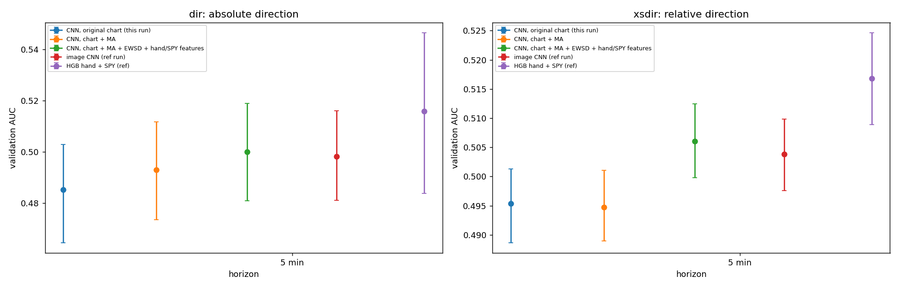

# indicator_20261119_193203 (QUICK, direction)

`IndicatorChart_CNN.ipynb` with `QUICK = True`:
- targets: `xsdir` and `dir`, both at 5 minutes;
- variants: `plain`, `ma`, `ma_ewsd_tab`;
- 40,000 training windows and 49 validation days.

| model | xsdir AUC | dir AUC |
|---|---|---|
| CNN, original chart | 0.495 | 0.485 |
| CNN, chart + MA | 0.495 | 0.493 |
| CNN, chart + MA + EWSD + hand/SPY features | 0.506 | 0.500 |
| image CNN (reference run) | 0.504 | 0.498 |
| HGB hand + SPY (reference run) | 0.517 | 0.516 |

No direction signal. Every CNN's 95% interval contains 0.5, and every model's log loss is no better than the training prior (the change is −0.7% to +0.02%).

The MA line does not help direction either (+0.004 on average, inside the noise). HGB's xsdir AUC of 0.517 is statistically above 0.5, but its probabilities are no better than the prior.
