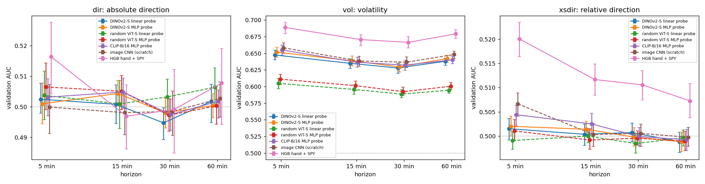

# probe_20261118_031436 (full run)

`FrozenEncoder_Probe.ipynb`, `QUICK = False`, features on the Colab disk only: 300,000 training windows, all of 2023
minus the embargo (243 days, ~564,000 rows per cell), 12 cells (vol / xsdir / dir × 5 / 15 / 30 / 60 min), encoders
DINOv2-S, random ViT-S and CLIP ViT-B/16, linear and MLP probes with and without SPY features. About 5 hours on Colab.
CNN/HGB scores from `run_20261116_044159`, joined on identical rows.

Files: the executed notebook is `../../FrozenEncoder_Probe.ipynb` (run with `drive_dir=None` in section 5, which is what
`FEATURES_ON_DRIVE = False` now does); `probe_table.csv` (every cell and model, with 95% day-bootstrap CIs, log-loss gain,
probe parameters); `takeaways.md` (generated by the notebook); `probe_auc_by_horizon.png`.

Validation AUC, vol (5 / 15 / 30 / 60 min):

| model | AUC |
|---|---|
| HGB hand + SPY | 0.689 / 0.671 / 0.666 / 0.679 |
| image CNN (scratch) | 0.658 / 0.638 / 0.637 / 0.648 |
| DINOv2-S + SPY linear probe | 0.658 / 0.640 / 0.634 / 0.645 |
| CLIP-B/16 MLP probe | 0.655 / 0.636 / 0.632 / 0.640 |
| DINOv2-S MLP probe | 0.652 / 0.639 / 0.629 / 0.642 |
| DINOv2-S linear probe | 0.647 / 0.635 / 0.628 / 0.638 |
| random ViT-S MLP probe | 0.611 / 0.601 / 0.592 / 0.600 |

- Pretraining matters: DINOv2 beats the same architecture with random weights by ~0.04 on vol (paired bootstrap over 12 cells: better in 5, worse in 1, tied in 6 for the linear probe).
- Frozen probes nearly match the scratch image CNN (mean −0.002 to −0.003 AUC; never better, worse in 4–5 of 12 cells).
- CLIP ≈ DINOv2 (better 2, worse 2, tied 8); MLP ≈ linear (+0.0016); SPY features add nothing (−0.0014).
- HGB hand + SPY beats the best frozen probe in 10 of 12 cells (mean +0.0185) and is best everywhere.
- dir and xsdir: every image model ~0.50; only HGB reaches 0.51–0.52.

Parameters: encoders frozen (DINOv2-S and random ViT-S ~22M, CLIP ViT-B/16 ~86M); trainable probe 769 (DINOv2 linear) to
1,573,889 (CLIP + SPY MLP), per `probe_table.csv`.
