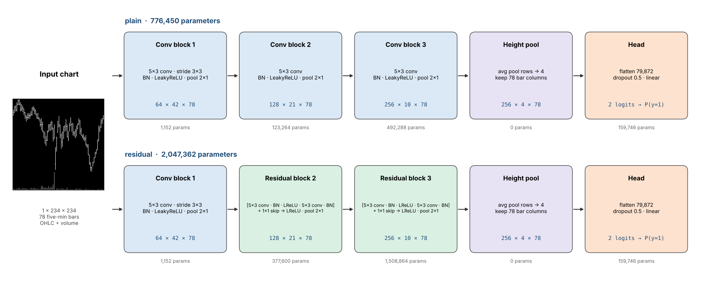

# CNN-Relevant

Chart-image CNN for 5-minute US equity bars (Jiang–Kelly–Xiu style), a ResNet-style variant, and a 1D CNN on the raw OHLCV numbers to test whether the image itself helps.

## Run (Google Colab)

1. Drive layout:
   - `Colab Notebooks/EC/Project/Demo/cnn78u_colab_bundle.zip` (data)
   - `Colab Notebooks/EC/Project/Demo/CNN-Relevant/` (this folder: notebook + `chartcnn/`)
2. Open `ChartCNN_Baseline.ipynb`, select a GPU runtime, **Run all**.
3. Outputs go to `Demo/CNN-Relevant/runs/<RUN_ID>/` (per run `<experiment>_<arch>/`, plus `analysis.csv`, `analysis.png`, `takeaways.md`).

## Layout

| Path | Content |
|---|---|
| `ChartCNN_Baseline.ipynb` | Main notebook: setup → models → frame correlation → train → results → analysis → test (off) |
| `chartcnn/data.py` | Labels (`vol`, `xs_dir`, `dir`), stride thinning, on-the-fly chart dataset |
| `chartcnn/images.py` | OHLCV window → 234×234 chart |
| `chartcnn/models.py` | `ChartCNN(arch="plain" \| "residual")`, `parameter_table` |
| `chartcnn/baselines.py` | Training prior, simple rules, HistGradientBoosting on hand features |
| `chartcnn/training.py` | Training loop, early stopping, resume, experiment runner, one-shot test |
| `chartcnn/evaluation.py` | AUC, log loss vs prior, decile long-short |
| `chartcnn/analysis.py` | Post-run analysis: plain vs residual, CNN vs baselines (day-bootstrap CIs), calibration, long-short, auto takeaways |
| `chartcnn/frame_corr.py` | Frame (image) / label / prediction correlation by lag, ICC, effective sample size |
| `results/frame_corr/` | Frame-correlation results on April 2023 validation data |
| `diagnostics/` | Signal-ceiling checks with hand features (`ceiling.py`, `horizons.py`) |
| `previous/` | Earlier single-file notebook (`CNN_Paper_Style_Targets.ipynb`) |
| `tools/` | Scripts that regenerate the diagram and the notebook |

## Models

| arch | blocks 2–3 | parameters |
|---|---|---|
| `plain` | Conv 5×3 → BN → LeakyReLU → MaxPool 2×1 | 776,450 |
| `residual` | [Conv → BN → LReLU → Conv → BN] + 1×1 skip → LReLU → MaxPool 2×1 | 2,047,362 |
| `series1d` | No image: the same 78-bar window as a (5, 78) OHLCV sequence, scaled like the chart; 3 × [Conv1d k=5 → BN → LeakyReLU] (128/256/384 channels) → Linear | 720,770 |
