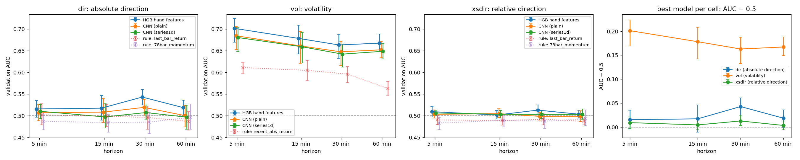

# Multi-Target Chart CNN Baseline

Is there a signal in the **direction** of the next intraday move, or only in its **size**?
This folder trains the chart CNN on a grid of 3 target kinds × 4 horizons (12 cells) and plots
validation AUC with day-bootstrap intervals against the horizon.

| kind | label | 5 min | 15 min | 30 min | 60 min |
|---|---|---|---|---|---|
| `dir` | return over the horizon strictly positive (zero returns dropped) | `dir_h1` | `dir_h3` | `dir_h6` | `dir_h12` |
| `vol` | \|return\| above the stock's training-period median \|return\| for that horizon | `vol_h1` | `vol_h3` | `vol_h6` | `vol_h12` |
| `xsdir` | return above the cross-sectional median at the same bar | `xsdir_h1` | `xsdir_h3` | `xsdir_h6` | `xsdir_h12` |

5 min (`h1`) is kept as the reference that the earlier ChartCNN runs used.

## Design

- **Data**: bundle v2 (2023 H1, ~528 stocks), train to 2023-03-31, validate on
  April 2023. Test (May–June) is not touched. v2 has the same bars as v1 but keeps every window:
  v1 had dropped windows whose next-bar return was exactly zero (4.6% of them), which selects on
  future data. Direction targets now drop zero returns themselves, per target and horizon.
- **Labels** use unadjusted (traded) prices, as the price-adjustment policy requires. A label whose
  horizon contains an ex-date (only possible across the overnight gap) is dropped, because its
  unadjusted return would include the split or dividend jump: 0.02% of windows at 5 minutes,
  0.2% at 60 minutes.
- **Inputs**: one trading day of 78 five-minute bars, adjusted point in time to the window's last bar
  (`chartcnn.images.point_in_time_window`), drawn as a 234×234 chart or fed as raw OHLCV numbers.
- **Stride 12 for every horizon**: one sample per stock per hour (~143k train / ~42k validation per
  cell). Stride ≥ horizon, so one stock's labels never overlap, and all 12 cells share the same
  decision times, so a change across horizons is not a change in sample.
- **Models per cell**: `plain` image CNN (776,450 parameters), `series1d` 1D CNN on raw OHLCV
  (720,770 parameters), HistGradientBoosting on 20 hand features (tree-node count printed), and
  simple rules. Every model prints its parameter count. The residual CNN is left out to save GPU time
  (in `run_20261114_020923` it tied the plain CNN at 2.6× the cost); add `"residual"` to `ARCHS` to include it.
- **Training**: same as ChartCNN_Baseline (Adam lr 1e-5, batch 128, up to 12 epochs, early stop on
  validation log loss with patience 2, seed 69), plus bfloat16 autocast on A100/L4/H100 (`amp=True`).
- **Analysis**: AUC per cell and model with 95% day-bootstrap CI, log-loss gain vs the training
  prior, decile long-short for the direction kinds, paired image-vs-1D and CNN-vs-HGB comparisons,
  and auto-generated takeaways.

## Run (Google Colab)

1. Drive layout:
   - `Colab Notebooks/EC/Project/Demo/cnn78u_colab_bundle.zip` (the existing data zip). The notebook
     turns it into v2 at start-up (about 30 seconds: same bars, all windows kept). If
     `cnn78u_colab_bundle_v2.zip` is in `Demo/`, that is used instead.
   - `Colab Notebooks/EC/Project/Demo/Multi-Target Chart CNN Baseline/` (this folder: notebook, `chartcnn/`)
2. Open `Multi_Target_Chart_CNN.ipynb`, Runtime → Change runtime type → GPU (L4 or A100), **Run all**.
3. The run id is printed in section 2. Outputs go to `runs/<RUN_ID>/`.
4. **After a disconnect**: set `RUN_ID = "<that id>"` in section 2 and Run all again. Finished cells
   are loaded from Drive; the unfinished one continues from its last saved epoch.

Measured on an L4 with bfloat16 (`run_20261114_223246`): 5–8 minutes per cell, **68 minutes** for all 12.

## Results: run `run_20261114_223246` (Colab L4)

Bundle v2 (converted from the v1 zip at start-up), chartcnn 2026-11-14.3, stride 12, train to
2023-03-31, validate on April 2023 (19 days, ~42–45k samples per cell). Test not evaluated.
AUC with 95% day-bootstrap CI; log loss relative to the training prior. Settings: Adam lr 1e-5,
batch 128, early stop patience 2 (every CNN stopped within 3–5 epochs), bfloat16, seed 69.
Parameters: plain CNN 776,450, 1D CNN 720,770; HGB tree nodes are printed in the notebook.

| target | horizon | CNN (plain) | 1D CNN (series1d) | HGB hand features |
|---|---|---|---|---|
| `dir` | 5 min | 0.507 [0.489, 0.526] | 0.510 [0.493, 0.526] | 0.516 [0.496, 0.535] |
| `dir` | 15 min | 0.508 [0.484, 0.540] | 0.497 [0.472, 0.527] | 0.517 [0.490, 0.546] |
| `dir` | 30 min | 0.519 [0.499, 0.537] | 0.507 [0.491, 0.525] | 0.543 [0.525, 0.561] |
| `dir` | 60 min | 0.500 [0.474, 0.524] | 0.497 [0.469, 0.524] | 0.519 [0.499, 0.536] |
| `vol` | 5 min | 0.684 [0.653, 0.705] | 0.680 [0.648, 0.704] | 0.701 [0.669, 0.724] |
| `vol` | 15 min | 0.661 [0.621, 0.694] | 0.659 [0.621, 0.691] | 0.678 [0.642, 0.708] |
| `vol` | 30 min | 0.647 [0.616, 0.672] | 0.642 [0.612, 0.665] | 0.663 [0.632, 0.687] |
| `vol` | 60 min | 0.652 [0.634, 0.671] | 0.648 [0.631, 0.667] | 0.667 [0.649, 0.688] |
| `xsdir` | 5 min | 0.503 [0.494, 0.513] | 0.506 [0.501, 0.512] | 0.509 [0.497, 0.521] |
| `xsdir` | 15 min | 0.505 [0.496, 0.516] | 0.503 [0.495, 0.512] | 0.502 [0.493, 0.512] |
| `xsdir` | 30 min | 0.499 [0.490, 0.508] | 0.503 [0.494, 0.513] | 0.513 [0.504, 0.525] |
| `xsdir` | 60 min | 0.499 [0.487, 0.511] | 0.503 [0.492, 0.516] | 0.504 [0.495, 0.513] |

- **Volatility is predictable at every horizon** (AUC 0.64–0.70, all CIs far above 0.5; log loss
  3–12% better than the prior). It is highest at 5 minutes and flattens from 30 minutes.
- **Direction is not.** Every CNN's absolute- and relative-direction AUC is within about 0.02 of 0.5,
  every CNN CI contains 0.5 or barely clears it, and every CNN direction model has worse log loss than
  the training prior (−0.2% to −3.1%). The only CIs above 0.5 are HGB `dir_h6` (0.543, log loss
  +0.2%) and HGB `xsdir_h6` (0.513), and the 1D CNN at `xsdir_h1` (lower bound 0.501). With 24
  direction model-cells tested, two or three marginal ones are about what chance gives; none would
  survive a multiple-testing correction, and none is supported at neighbouring horizons.
- Decile long-short (gross, top − bottom): only HGB `dir_h1` (+3.5 bps, t = 2.14) and 1D CNN
  `xsdir_h6` (+3.9 bps, t = 2.03) pass |t| ≥ 2, again about what 24 tries give by chance, and far
  below costs.
- **The picture adds nothing.** Image CNN vs 1D CNN on the same raw numbers (paired day bootstrap):
  better in 2 of 12 cells, tied in 10. HGB on 20 hand features beats or ties the image CNN in every
  cell (better in 5, tied in 7).
- `dir` log loss is also hurt by a level shift: April was an up month (validation positive share
  0.515–0.542 vs 0.496–0.511 in training).

Files in `results/run_20261114_223246/`: `grid_table.csv` (every model and rule per cell),
`labels.csv`, `takeaways.md` (generated), `auc_by_horizon.png`, `settings.json`.
`Multi_Target_Chart_CNN.ipynb` here is the executed notebook with all outputs. Not in git (on Drive in
`runs/run_20261114_223246/`): per-cell `predictions.parquet`, checkpoints and training histories.

## Outputs (`runs/<RUN_ID>/`)

| file | content |
|---|---|
| `settings.json` | settings, cells, architectures, chartcnn version |
| `labels.csv` | samples and positive share per cell and split |
| `<cell>/predictions.parquet` | validation labels, returns and every model's score |
| `<cell>/done.json` | parameters, best epochs, prior, minutes taken |
| `<cell>/<arch>/` | `best.pt`, `last.pt`, `history.csv` |
| `grid_table.csv` | one row per (cell, model): AUC and CI, log-loss gain, long-short, parameters |
| `auc_by_horizon.png` | AUC vs horizon per kind, and the best model's AUC − 0.5 for all kinds |
| `takeaways.md` | generated conclusions |

## Code

The grid logic is `chartcnn/grid.py`. In the repository, `chartcnn/` lives once, in `../CNN-Relevant/`,
and the notebook falls back to it. On Drive, a copy of `chartcnn/` sits in this folder so that the
`CNN-Relevant` folder there is not changed. `tools/make_notebook.py` regenerates the notebook.
